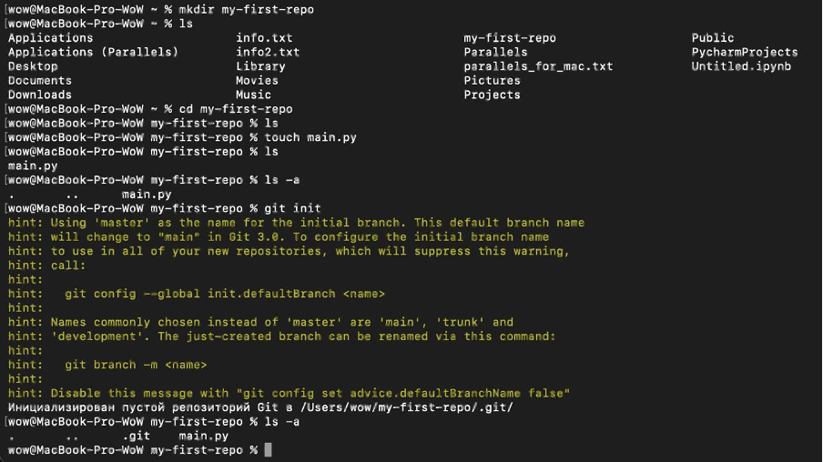
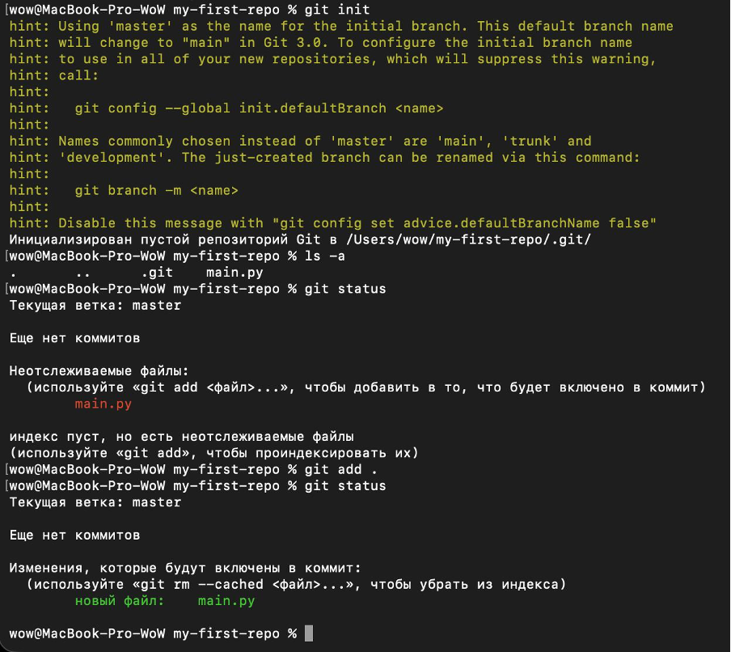
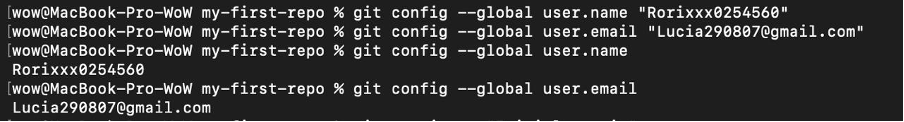
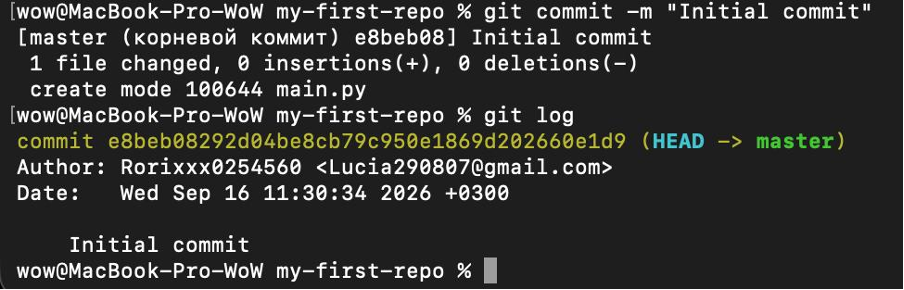
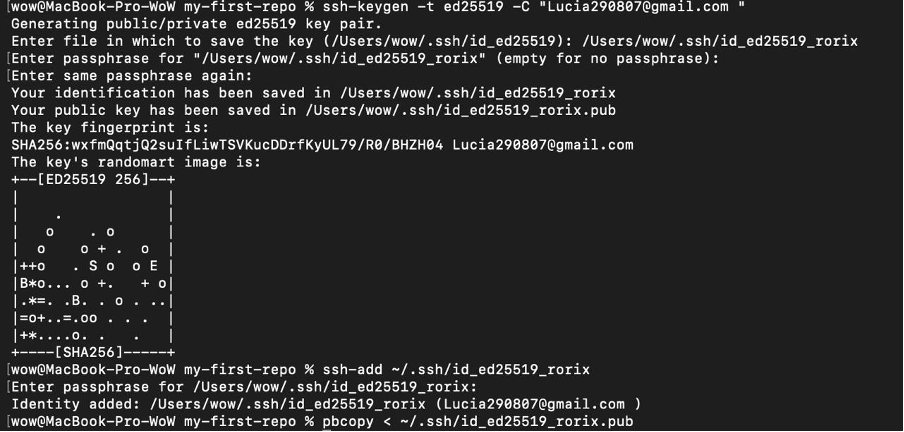
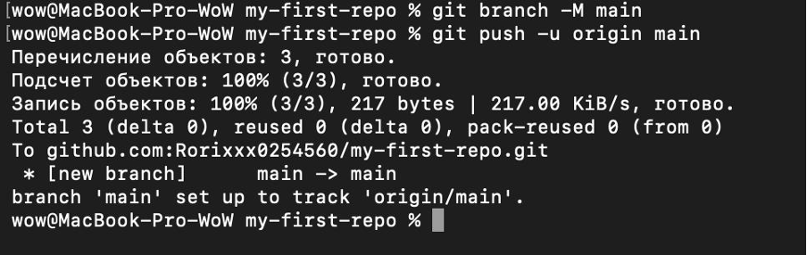
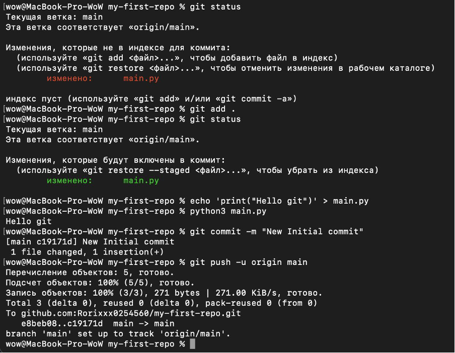
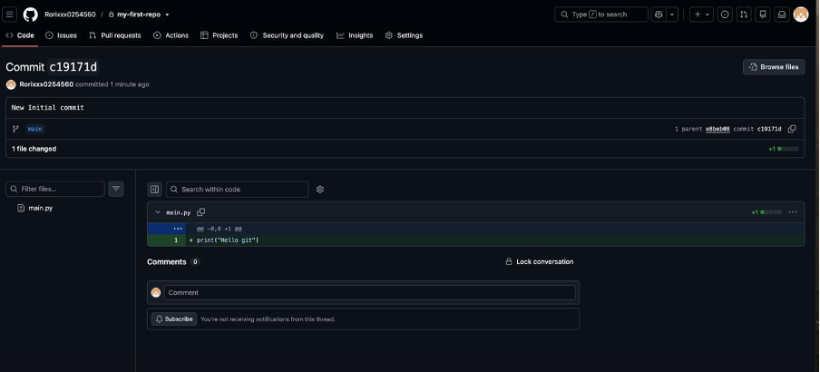

# Лабораторная работа №1

## Основы работы с Git и GitHub

### Цель работы

Изучить основы работы с системой контроля версий **Git** и получить практические навыки создания локального репозитория, добавления файлов, создания коммитов, подключения удалённого репозитория GitHub и отправки в него изменений.

---

## Ход работы

В ходе лабораторной работы была выполнена настройка системы контроля версий Git, создан локальный репозиторий, сформированы коммиты и настроено взаимодействие с удалённым репозиторием на GitHub.

### 1. Создание проекта и инициализация Git-репозитория

В терминале была создана новая директория `my-first-repo` с помощью команды:

```bash
mkdir my-first-repo
```

Затем выполнен переход в неё, создан файл `main.py` и инициализирован локальный Git-репозиторий:

```bash
cd my-first-repo
touch main.py
git init
```



---

### 2. Проверка состояния репозитория и добавление файла в индекс

После инициализации была выполнена команда:

```bash
git status
```

Она показала, что файл `main.py` является неотслеживаемым. Для добавления файла в индекс была использована команда:

```bash
git add .
```

После повторного выполнения `git status` файл `main.py` отображался в разделе изменений, которые будут включены в следующий коммит.



---

### 3. Настройка данных пользователя Git

Перед созданием первого коммита были настроены имя пользователя и адрес электронной почты. Для этого использовались команды `git config`:

```bash
git config --global user.name "имя_пользователя"
git config --global user.email "электронная_почта"
```

После этого значения параметров были проверены с помощью команд:

```bash
git config --global user.name
git config --global user.email
```

Эти данные используются Git для указания автора создаваемых коммитов.



---

### 4. Создание первого коммита и просмотр истории

После добавления файла в индекс был создан первый коммит:

```bash
git commit -m "Initial commit"
```

Коммит сохранил текущее состояние проекта в истории Git. Для просмотра истории созданных коммитов была использована команда:

```bash
git log
```



---

### 5. Создание и подключение SSH-ключа

Для безопасного подключения локального Git-репозитория к GitHub был создан SSH-ключ типа **ED25519** с помощью команды `ssh-keygen`:

```bash
ssh-keygen -t ed25519
```

После создания ключ был добавлен в SSH-агент командой `ssh-add`. Публичная часть ключа была скопирована для последующего добавления в настройки аккаунта GitHub.

Это позволяет выполнять операции с удалённым репозиторием без постоянного ввода данных учётной записи.



---

### 6. Отправка локального репозитория на GitHub

Перед отправкой изменений основная ветка локального репозитория была переименована из `master` в `main`:

```bash
git branch -M main
```

После подключения удалённого репозитория изменения были отправлены на GitHub командой:

```bash
git push -u origin main
```

В результате локальная ветка `main` была успешно отправлена в удалённый репозиторий и настроена для отслеживания ветки `origin/main`.



---

### 7. Изменение файла и повторная отправка изменений

После первой отправки репозитория файл `main.py` был изменён. В него была добавлена строка:

```python
print("Hello git")
```

Состояние файла было проверено командой `git status`, после чего изменения были добавлены в индекс с помощью `git add .`.

Работоспособность программы была проверена командой:

```bash
python3 main.py
```

В терминале был получен результат:

```text
Hello git
```

После этого был создан новый коммит:

```bash
git commit -m "New Initial commit"
```

Новый коммит был отправлен в удалённый репозиторий с помощью:

```bash
git push -u origin main
```



---

### 8. Проверка результата на GitHub

После выполнения команды `git push` был открыт удалённый репозиторий на GitHub. В истории репозитория появился новый коммит `New Initial commit`, а в файле `main.py` отобразилась добавленная строка:

```python
print("Hello git")
```

Таким образом была подтверждена успешная синхронизация локального Git-репозитория с удалённым репозиторием GitHub.



---

## Вывод

В ходе лабораторной работы были изучены основные команды Git: `git init`, `git status`, `git add`, `git config`, `git commit`, `git log`, `git remote` и `git push`.

Был создан локальный Git-репозиторий, выполнен первый коммит, подключён удалённый репозиторий на GitHub и успешно отправлены локальные изменения. В результате были получены базовые навыки работы с **Git и GitHub**.
